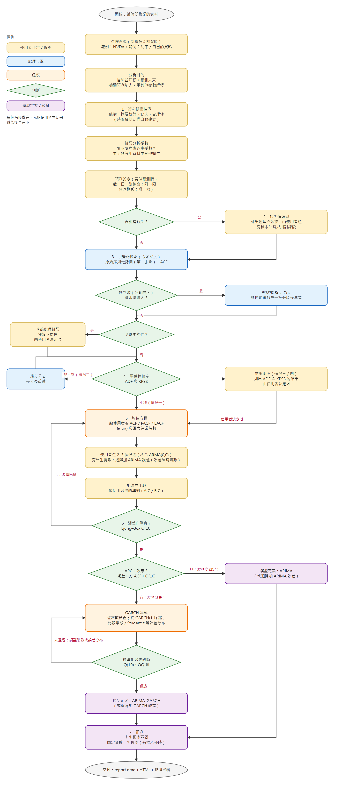
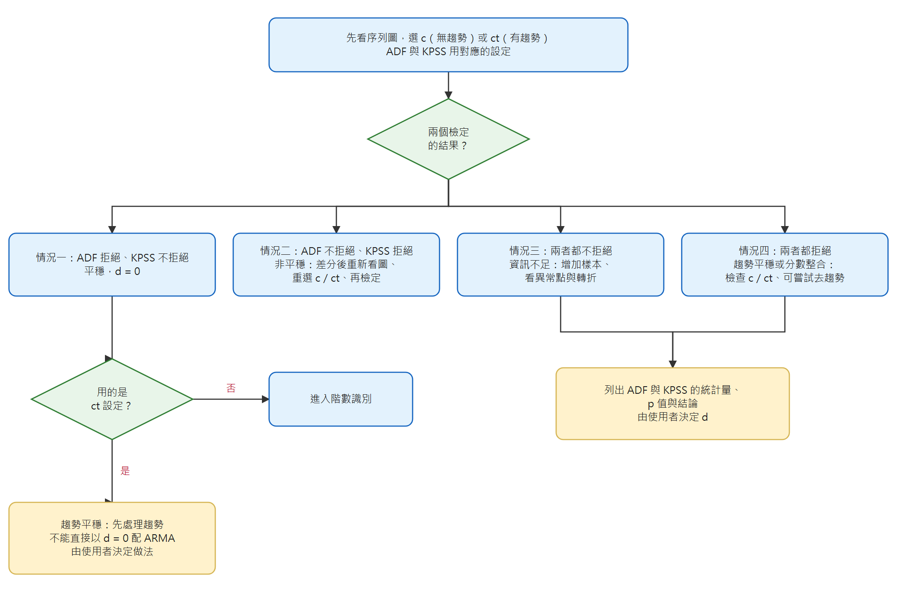
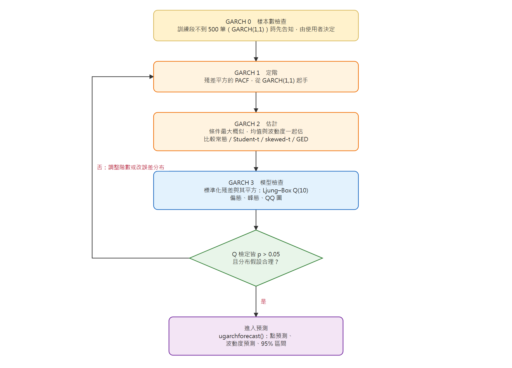

# 分析目的與適用問題

::: {.chapter-lead}
依固定順序完成探索、平穩性判斷、模型配適與比較、殘差診斷，最後給出預測與 95% 預測區間。每個需要選擇的步驟都由使用者決定
:::

本指南整理 `timeseries-analysis` 這個 skill 的做法，供閱讀報告時查詢：**每一張圖、每一個檢定是什麼、什麼時候用、怎麼看、得到什麼結論**，並附上完整的決策流程圖與操作規格。指南不含推導。

## 可以問的問題

| 問題 | 對應的步驟 |
|---|---|
| 這筆資料有沒有趨勢、季節、起伏忽大忽小？ | 資料健康檢查、視覺化探索 |
| 資料平穩嗎？要不要差分、差幾次？ | 平穩性與差分（ADF 與 KPSS） |
| 下一期（或未來 12 期）大概會是多少？不確定性多大？ | 模型配適、預測與 95% 預測區間 |
| 報酬的波動是否忽大忽小？風險未來會多高？ | 殘差第二層診斷、GARCH、波動度預測 |
| 能不能用另一個變數解釋目標變數（例如用 1 年期利率解釋 3 年期利率）？ | 確認分析目標、迴歸加 ARIMA 誤差或迴歸加 GARCH 誤差（ARIMAX） |

## 這個 skill 不處理的事

- **季節效應**：預設**不處理**，看到明顯季節性時先告知使用者並詢問。使用者需要時，才給季節差分階數 D 的建議。
- **長季節與多重季節**（例如日資料的年週期）：不處理，會告知並在報告註明。
- **因果與保證**：模型描述的是統計關係，預測區間是「在模型成立的前提下」的區間，不是保證。

## 運作原則

1. 分析依序分為 7 個階段：1 資料健康檢查、2 缺失值處理、3 視覺化探索、4 平穩性與差分、5 建模、6 殘差診斷、7 預測。健康檢查後先確認分析目標（含是否考慮外生變數），要做預測時再設定預測條件，之後才處理缺失值。**使用者掌控分析是本 skill 最重要的原則。**
2. 每個階段做完，先給使用者看結果，確認後才往下。
3. 遇到需要選擇的步驟就停下來，簡述選項、依據與預設做法，由使用者決定。不替使用者選。
4. 預設是手動、可逐步檢視的做法。fpp3 的自動化工具（`tsibble`、`fable`、`auto.arima()` 等）只在使用者選擇時採用。
5. 檢定與診斷只是**證據**，不是自動決策規則。結果衝突時，把各項檢定的統計量、p 值與結論都列在報告中，由使用者決定（見第 7 章）。

# 範例資料集

::: {.chapter-lead}
附在 `examples/data/` 的兩組資料，供測試 skill 使用：各是什麼資料、打算用時間序列方法完成什麼分析目標
:::

以斜線指令 `/timeseries-analysis` 觸發、沒有指定資料時，skill 會先問要分析哪份資料：範例 1（NVIDIA 日資料）、範例 2（公債利率週資料），或使用者自己的資料。兩組資料分別對應 skill 的兩種主要用法：**單變量 ARMA（必要時接 GARCH）＋預測**，以及**外生變數（迴歸加時間序列誤差，並接 GARCH 誤差）**。只附原始資料，不附分析結果，測試者可以從頭用 skill 走一次流程。

| 檔案 | 資料 | 期間與頻率 | 筆數 | 來源 |
|---|---|---|---|---|
| `nvda_daily.csv` | NVIDIA（NVDA）每日收盤價：`date`、`adj_close`（調整後收盤價）、`close` | 2023-01-03 至 2026-11-19，交易日 | 975 | Yahoo Finance，以 R 套件 `quantmod` 取得 |
| `w-gs1yr.txt`、`w-gs3yr.txt` | 美國 1 年期與 3 年期公債固定期限利率：`year`、`mon`、`day`、`rate`（年利率 %） | 1962-01-05 至 2009-04-10，每週 | 各 2,467 | Tsay (2010) 第 3 版配套資料（第 2 章本章資料、第 4 章習題 6） |

## NVIDIA 日資料：報酬率建模與樣本外預測

- **資料特性**：股價屬金融資產價格，skill 會先畫價格走勢圖，再轉成對數報酬分析。
- **分析目標**：設定訓練截止日（例如 2026-10-30），以截止日以前的報酬建立 ARMA 均值方程，檢查是否有 ARCH 效應。之後對樣本外的交易日做**多步預測**與**固定參數一步預測**，比較實際報酬是否落在 95% 區間內，並由報酬回算價格。
- **會用到的方法**：對數報酬、ADF＋KPSS、ACF／PACF／EACF 與 `ar()` 選階、殘差兩層診斷、預測設定（截止日、訓練窗、預測期數）、報酬回算價格。

## 美國公債利率週資料：迴歸加時間序列誤差（ARIMAX＋GARCH）

- **資料特性**：兩個利率都不平穩，且高度同步。
- **分析目標**：以 1 年期利率的週變化解釋 3 年期利率的週變化。先示範水準對水準的迴歸屬於假性迴歸，改用變化量後，為迴歸誤差選定 ARMA 階數（誤差須有階數），再因殘差的 ARCH 效應接上 GARCH 誤差。最後依使用者選擇的目的做預測（例如代入實際 1 年期利率變化的**條件預測**）。
- **會用到的方法**：確認分析目標與外生變數的三種目的、假性迴歸的檢查、迴歸加 MA(1)／AR(1)／ARMA(1,1) 誤差的比較、迴歸加 GARCH 誤差（`rugarch` 的 `external.regressors`）。

::: {.callout-note}
資料的著作權屬原始提供者：NVIDIA 股價來自 Yahoo Finance，公債利率來自 Tsay 的教材配套資料，僅供測試與教學使用。
:::

# 基本觀念

::: {.chapter-lead}
平穩、差分、ACF／PACF、ARMA 與 GARCH 這些名詞各自代表什麼
:::

## 時間序列的三種型態

- **趨勢**：長期上升或下降。
- **季節性**：固定週期、與日曆有關的重複起伏（例如每年夏天偏高）。
- **循環**：起伏但週期不固定，通常與景氣有關。

分辨季節與循環，看起伏的**時間是否固定**：固定週期是季節性，不固定是循環。（fpp3 §2.3）

## 平穩、白噪音與差分

- **平穩**：序列的統計性質**不隨時間改變**——沒有長期趨勢、沒有季節性、起伏大致一樣大。多數傳統模型（如 ARIMA）要求資料平穩。
- **白噪音**：完全隨機、各期互不相關的序列，是平穩的。殘差若像白噪音，代表模型已把可用的規律抓完。
- **差分**：用「這期減上一期」得到變化量，可以去掉趨勢。**季節差分**用「這期減去年同期」，去掉季節。**盡量少差分**，過度差分會製造出實際不存在的假自相關。
- **例子（講義）**：價格序列不平穩，但取一階差分後的對數報酬平穩。

出處：fpp3 §9.1。Tsay 講義 lec3。

## 自相關圖：ACF 與 PACF

- **ACF**：每個落後期 k 的柱子，代表「現在的值」與「k 期前的值」的相關程度。有趨勢時，小落後期的自相關大且為正，隨落後期**緩慢下降**。有季節性時，在**季節週期的倍數**特別大。平穩序列的自相關很快掉到接近 0。
- **PACF**：只看「k 期前」對現在的**直接**影響（扣掉中間期的間接影響）。
- **藍色虛線**：判斷自相關是否顯著不為 0。序列若是白噪音，約 95% 的柱子應落在虛線內。有一根或多根大柱子超出、或超出比例明顯高於 5%，表示還有可利用的規律。

出處：fpp3 §2.8–2.9、§9.1、§9.5。Tsay 講義 lec3。

## ARMA、ARIMA 與 SARIMA

以 $y_t$ 表示第 t 期的觀測值（例如報酬率），$a_t$ 表示第 t 期的隨機衝擊（白噪音：平均 0、變異數固定、各期互不相關）。

- **AR(p)**：用過去 p 期的**自身**資訊。

$$
y_t = \phi_0 + \phi_1 y_{t-1} + \cdots + \phi_p y_{t-p} + a_t
$$

- **MA(q)**：用過去 q 期的**衝擊**資訊。

$$
y_t = \mu + a_t + \theta_1 a_{t-1} + \cdots + \theta_q a_{t-q}
$$

- **ARMA(p,q)**：兩者兼用。

$$
y_t = \phi_0 + \sum_{i=1}^{p} \phi_i y_{t-i} + a_t + \sum_{j=1}^{q} \theta_j a_{t-j}
$$

- **ARIMA(p,d,q)**：先差分 d 次再配 ARMA。以 $\nabla y_t = y_t - y_{t-1}$ 表示一次差分，ARIMA(p,1,q) 就是對 $\nabla y_t$ 配 ARMA(p,q)。
- **SARIMA** 寫成 (p,d,q)(P,D,Q)[m]：前括號是非季節部分，後括號是季節部分，[m] 是季節週期。d 與 D 是一般差分與季節差分的次數。
- 本 skill 預設 **d、D 由前面的平穩性步驟決定、不處理季節（D = 0）**。

MA 項的正負號依 R 的寫法（$+\theta_j a_{t-j}$）。Tsay 講義寫成 $-\theta_j a_{t-j}$，係數的正負號相反，意義相同。

出處：fpp3 §9。Tsay 講義 lec3（airline 模型 (0,1,1)(0,1,1)）。

## 波動度：ARCH 與 GARCH

前面只關心「平均水準」有沒有被模型抓住。但金融報酬的**起伏大小**常會群聚——一段時間很平靜，另一段時間很劇烈。講義的基本想法：報酬的衝擊**沒有自相關，但彼此不獨立**，依賴是非線性的，所以要另外檢查「起伏的大小」。

**符號**：

- $r_t$：第 t 期的報酬率。
- $\mu_t$：均值方程給出的第 t 期平均（例如上一節的 ARMA，或常數 $\mu$）。
- $a_t = r_t - \mu_t$：均值方程的殘差，也就是第 t 期的衝擊。
- $\sigma_t^2$：條件變異數，在已知第 t−1 期以前所有資訊下，$a_t$ 的變異數，代表這一期的波動度。
- $\epsilon_t$：標準化的隨機項，各期獨立、平均 0、變異數 1（常態或標準化的 Student-t）。

衝擊寫成 $a_t = \sigma_t\,\epsilon_t$：$\epsilon_t$ 決定方向與相對大小，$\sigma_t$ 決定這一期的波動有多大。

- **ARCH(q)**：現在的波動度依賴過去 q 期的衝擊大小。

$$
\sigma_t^2 = \alpha_0 + \alpha_1\, a_{t-1}^2 + \cdots + \alpha_q\, a_{t-q}^2,\qquad \alpha_0 > 0,\ \alpha_i \ge 0
$$

  過去的衝擊 $a_{t-i}$ 越大，這一期的條件變異數 $\sigma_t^2$ 就越大，所以大波動之後容易接著大波動。

- **GARCH(1,1)**：現在的波動度依賴上一期的衝擊與**上一期的波動度**，能以較少的參數描述波動的持續性。

$$
\sigma_t^2 = \omega + \alpha_1\, a_{t-1}^2 + \beta_1\, \sigma_{t-1}^2,\qquad \omega > 0,\ \alpha_1 \ge 0,\ \beta_1 \ge 0
$$

  $\alpha_1 + \beta_1 < 1$ 才有固定的長期變異數。越接近 1，波動越持續。

**怎麼檢定有沒有 ARCH 效應**（對均值方程的殘差 $a_t$，T 為樣本數）：

1. **殘差平方的 Ljung–Box 檢定**：H₀ 為 $a_t^2$ 在前 m 期沒有自相關（沒有 ARCH 效應）。

$$
Q(m) = T(T+2)\sum_{k=1}^{m} \frac{\hat\rho_k^2}{T-k} \;\sim\; \chi^2_m
$$

   其中 $\hat\rho_k$ 是 $a_t^2$ 的第 k 期樣本自相關。本 skill 取 m = 10。

2. **ARCH LM 檢定**（Engle, 1982，作為補充）：做輔助迴歸

$$
a_t^2 = \alpha_0 + \alpha_1\, a_{t-1}^2 + \cdots + \alpha_m\, a_{t-m}^2 + e_t
$$

   H₀ 為 $\alpha_1 = \cdots = \alpha_m = 0$（沒有 ARCH 效應）。檢定統計量 $LM = T R^2 \sim \chi^2_m$，$R^2$ 是輔助迴歸的判定係數（R 的 `FinTS::ArchTest()` 報告的就是這個統計量）。

兩個檢定的 p 值小於 0.05，就表示殘差平方有自相關，存在波動聚集（ARCH 效應）。

出處：Tsay 講義 lec4、Engle (1982)。

## 資訊準則與誤差分布

- **AIC／BIC**：比較候選模型的分數，**越小越好**，會懲罰太複雜的模型（BIC 懲罰較重）。這是**相對指標**：單一模型的分數沒有意義，至少要兩個候選才比得出來。
- **Student-t 誤差**：報酬常有厚尾，誤差分布除常態外可選 Student-t、skewed-t、GED。

# 資料輸入與健康檢查

::: {.chapter-lead}
分析之前先確認資料長什麼樣，並把需要使用者決定的事問清楚
:::

## 要確認的事

| 項目 | 做什麼 | 注意 |
|---|---|---|
| 時間欄與頻率 | 哪一欄是時間？每小時、日、月、季、年？ | 間隔是否規則。有沒有「跳號」的隱含缺失 |
| 分析對象 | 有兩個以上數值欄位時，先列出欄位、說明目前的判斷，由使用者選：（1）只分析一個。（2）分別分析多個，逐一各做一份。（3）用其他欄位解釋某個變數（外生變數，健康檢查後再問） | 使用者已明確指定變數時不重問 |
| 多序列 | 資料是不同店別、商品、測站混成的長表時，先問是否協助整理（例如合併成總銷量，或只取一個對象） | 合併方式依指標而定：銷量可加總，價格、溫度、比率通常不能直接加總。未經同意不自行合併 |
| 變數定義與單位 | 名稱、意義、度量單位 | 之後所有表格與圖軸一致標示單位 |
| 摘要統計 | 筆數、平均、標準差、最小、Q1、中位數、Q3、最大 | 平均與中位數差很多，表示偏向一邊或有極端值。有趨勢或季節的序列，「平均」會隨時間漂移 |
| 取對數的前提 | 所有觀測值是否嚴格大於 0 | 有零或負值不能取對數 |
| 數值合理性 | 符號與範圍、最大單期變動、單位一致 | 不做異常值的統計檢驗。偏離值只用時間圖目視，被看到的點**不等於資料錯誤** |
| 缺失值 | 找出並標記缺失位置（例如 `sum(is.na(x))`、跳號） | 這一步先不補，第 2 階段由使用者決定處理方式 |

時間資料結構（`ts`、`xts` 或時間已排序的 data.frame）由 skill 自動建立，不另問使用者。只有使用者選用 fpp3 工具時才轉成 tsibble。

**時間序列不能隨機刪除列**：刪掉中間幾筆會破壞時間間隔與落後關係，讓後面的 ACF、差分全部失真。缺一筆就讓它顯性地缺著。

## 偏態與超額峰態

敘述統計表中，平均、標準差、最小、最大任何序列都列出。偏態與超額峰態另外處理。偏態看分布偏哪一邊（0 表示左右對稱）。超額峰態看尾巴是否比常態厚（0 表示與常態相當，正值表示極端值較多）。**只在平穩化後的序列**（殘差、差分後、報酬率）上看。有趨勢或季節的原始序列不看，因為水準會隨時間漂移，算出來的數字容易誤導。

## 金融資產價格：預設轉成對數報酬

先依欄位名稱（close、price、adj_close 等）與數值特性判斷資料類型並告知使用者。無法判斷時先問，不自行假設。不是價格資料就不提這題。確認是股價、指數、匯率、加密貨幣收盤價等，**預設先轉成對數報酬**（今天的對數價格減昨天的對數價格，約等於漲跌的百分比），並告知使用者理由：**通常是報酬率才能拿來做時間序列分析。價格只在特定情境（例如共整合、配對交易的長期關係）才會直接分析**。價格通常不平穩、起伏隨價位放大。報酬率通常近似平穩，才適合進入後面的檢定與建模。轉換後的報酬要完整重跑探索：價格走勢圖（第一張圖）與報酬時間圖、六項摘要（平均、標準差、偏態、超額峰態、最小、最大）、報酬與報酬平方的 ACF（並以 ARCH 檢定檢查波動聚集），以及 ADF 與 KPSS。報告有預測時，另加一章「由報酬回算價格」：價格可由起始價精確回算，一步預測的價格＝前一日實際收盤價 × exp(報酬預測)，區間界線同樣換算，價格的點預測是中位預測而非平均預測。

出處：Tsay 講義 lec3、lec4。本 skill 的做法（`references/financial.md`）。

## 確認分析目標與外生變數（ARIMAX）

健康檢查的結果給使用者看過後，先問**分析目標**（要分析或預測哪個變數、目的為何），再問**要不要考慮外生變數**。

- **資料來源**：預設用資料中現有的其他數值欄位。使用者問到星期效應（例如 Monday effect）、假日效應時，才提供由日期產生的虛擬變數。
- **一定要問使用者想做哪一種**，三者的模型設定與報告寫法不同：

| 目的 | 外生變數的時點 | 預測 | 限制 |
|---|---|---|---|
| 解釋兩者的關係 | 同期（$x_t$ 解釋 $y_t$） | 代入預測期實際的 x，章名為「條件預測」 | 不是事前預測 |
| 事前預測 | 落後值（$x_{t-1}$ 解釋 $y_t$） | 只用預測起點已知的資訊 | 解釋力可能大幅下降 |
| 同期關係＋事前預測 | 同期 | 先為外生變數配時間序列模型並預測，再代入 | 區間要納入 x 的預測不確定性，較複雜 |

- **誤差一律要有 ARMA 階數**（例如迴歸加 MA(1)、AR(1)、ARMA(1,1) 誤差），不可以只用「均值加外生變數」。在迴歸中加入落後項而誤差仍為 ARMA(0,0) 的寫法也不列入候選。
- **假性迴歸**：目標與外生變數都不平穩時，水準對水準的迴歸 $R^2$ 再高也可能是假性迴歸。先檢查迴歸殘差是否平穩，不平穩就改用兩者的差分（Tsay 講義第 2 章以 1 年期利率解釋 3 年期利率的週資料為例）。
- **預測起點必須已知**：在預測起點 t 只能使用截至 t 已知的資訊。代入預測期實際外生變數值的預測只能稱「條件預測」，且這個名稱**只用在這種 ARIMAX**。
- 報告列出迴歸係數與 ARMA 係數的估計表，並解釋迴歸係數的意義（外生變數變動一單位，目標變數平均變動多少）。接 GARCH 時，均值方程放入外生變數（`rugarch` 的 `external.regressors`）。

出處：Tsay 講義 lec3（Regression Models with Time Series Errors）。本 skill 的做法。

# 前處理與平穩性

::: {.chapter-lead}
先看圖、再用 ADF 與 KPSS 兩個檢定判斷平穩，兩個檢定的結論衝突時，把兩者的結果都列出來，不自動決定
:::

## 缺失值

處理順序為：健康檢查 →（要預測時）預測設定 → **缺失值處理** → 視覺化。缺失會讓後面的圖、ACF、轉換與檢定失真，所以先處理。若已指定截止日，缺失值的判斷與補值**只使用訓練段**，避免用到未來資料。

| 情況 | 做法 |
|---|---|
| 沒有缺失 | 只在健康檢查寫一句，報告不設缺失值章節 |
| 缺失帶有資訊（例如商店假日休息） | 沒有自動補值方法：請使用者說明原因並決定，例如只取連續的一段，或把假日虛擬變數當外生變數 |
| 隨機缺失 | 給使用者選項與依據，由使用者決定，並記錄補了哪些、用什麼方法、為什麼 |

隨機缺失的選項：

| 選項 | 依據與限制 |
|---|---|
| 不補，直接建模 | R 的 `arima()` 允許缺失值。fpp3 §13.9：fable 的 ARIMA 可直接處理。限制：殘差含 NA。畫 ACF 要加 `na.action = na.pass`。不要用 `na.omit()` 刪缺失 |
| 只取最後一個缺失之後的連續段 | fpp3 §13.9。需要剩下的資料夠長 |
| 線性內插 | `forecast::na.interp()`、`zoo::na.approx()`。適合缺口短、序列平滑 |
| 前向填補 | `zoo::na.locf()`。適合階梯狀資料，對有趨勢或季節的序列會失真 |
| 季節性插補 | `imputeTS::na_seasplit()`（Moritz & Bartz-Beielstein, 2017） |
| 用 ARIMA 模型內插 | fpp3 §13.9 的做法 |

缺失比例與連續成段沒有文獻給出固定門檻。缺口很長或集中在特定時段時，任何內插都是在猜，要註明。

## 視覺化探索

**所有資料的第一張圖是原始序列的走勢圖**（未轉換、未差分，價格資料在轉成報酬之前先畫價格走勢圖）。**不畫箱形圖**，異常值只靠時間圖目視。預設用下面這組圖，從整體看到細節：

| 圖 | 看什麼 |
|---|---|
| **時間圖** | 趨勢、有無規律起伏、突發異常、起伏幅度是否隨水準變化 |
| **落後圖與 ACF** | 與過去各期的關聯強度。季節資料在季節週期倍數有高峰 |

季節圖（每年疊在一起）與子序列圖（同月份放在一起）**預設不畫**，因為預設不處理季節。使用者選擇處理季節時才補畫。

## 變異數穩定：對數轉換與 Box–Cox

- **什麼時候用**：序列水準越高、起伏越大時（例如旅客人數越多，季節高低差越大）。λ = 0 就是取對數。
- **怎麼判斷**：目的是看變異數（波動幅度）是否隨水準增大。先看原始尺度的圖，再把序列切成連續數段（月、季資料以年為段，沒有年週期或不到兩年時，切成等長的連續數段），比較各段標準差與平均，轉換前後各算一次。轉換前標準差隨平均上升、轉換後不再上升，才有效。**波動幅度沒有隨水準增大就不該硬轉**。取對數後的變化可解讀為比例（百分比）變化。
- **講義的理由**：處理指數成長（對數後成長變直線）與穩定變異。

轉換後再看一次自相關與分布。報告順序為**先探索、後轉換**：先在原始尺度呈現走勢圖與量化依據，再提出轉換的理由。

出處：Tsay 講義 lec3。fpp3 §3.1。量化檢查為本 skill 的做法。

## 平穩性檢定：ADF 與 KPSS 兩者都做

| 檢定 | H₀ | p < 0.05 的意思 |
|---|---|---|
| **ADF**（增強型 Dickey–Fuller） | 有單位根（不平穩） | 拒絕 H₀ → **平穩** |
| **KPSS** | 平穩 | 拒絕 H₀ → **不平穩** |

兩者的 H₀ **方向相反**，p 值的解讀完全相反，報告要特別註明。單位根代表序列像隨機漫步，會一直漂走、不會回到固定水準。ADF 的臨界值有專用表，請看軟體給的 p 值。

**先畫圖，再選檢定設定（c 或 ct）**：

| 序列圖 | 設定 | ADF（`fUnitRoots::adfTest`） | KPSS（`tseries::kpss.test`） |
|---|---|---|---|
| 沒有明顯趨勢、圍繞固定水準 | **c**（只含常數） | `type = "c"` | `null = "Level"` |
| 有明顯趨勢 | **ct**（常數與趨勢） | `type = "ct"` | `null = "Trend"` |

兩個檢定要用**對應的設定**。設定與圖形不一致是常見的誤判來源。R 實測：同一份資料（log AirPassengers，有趨勢與季節），ct 設定得到「平穩」，c 設定得到「非平穩」，所以要先看圖。KPSS 與 ADF 的 p 值有上下限（0.01、0.10），報告寫成「p < 0.01」或「p > 0.10」。

**兩個檢定的結果組合，分四種情況**：

| 情況 | ADF | KPSS | 結論與處理 |
|---|---|---|---|
| 一 | 拒絕 H₀ | 不拒絕 H₀ | **明確平穩**，d = 0。**但用 ct 設定時是「圍繞趨勢平穩」**，不能直接以 d = 0 配 ARMA，要先處理趨勢（納入時間趨勢項或先去趨勢，改用差分要留意過度差分），由使用者決定 |
| 二 | 不拒絕 H₀ | 拒絕 H₀ | **明確非平穩**，差分後重新看圖、選 c／ct、再檢定 |
| 三 | 不拒絕 H₀ | 不拒絕 H₀ | **資訊不足**（常見於樣本太少或有明顯轉折）：增加樣本、看圖找異常點。把 ADF 與 KPSS 的統計量、p 值與結論都列在報告中，由使用者決定 d |
| 四 | 拒絕 H₀ | 拒絕 H₀ | 可能是**趨勢平穩**或具**分數整合**特性：看圖確認有無趨勢、檢查 c／ct 設定、可嘗試去趨勢。把 ADF 與 KPSS 的統計量、p 值與結論都列在報告中，由使用者決定 |

::: {.callout-warning}
結合 ADF 與 KPSS 的做法源自 Kwiatkowski, Phillips, Schmidt & Shin (1992)。不同資料來源對「兩者結論衝突」的稱呼不一致（例如 statsmodels 文件把「兩者都不拒絕」稱為趨勢平穩），所以情況三、四一律把兩個檢定的結果都列出來，不自動判定。
:::

**一般差分階數 d**：先看序列的 ACF 圖（緩慢遞減提示仍不平穩），再依四種情況判斷。p 值落在邊際（約 0.05–0.10）要註明，並以差分後的 ACF 與殘差診斷檢視是否過度差分。`ndiffs()` 的預設只看 KPSS，不用來決定 d。使用者選擇處理季節時，d 對季節差分後的序列判斷。預設不處理季節時對原序列判斷，並在報告註明季節可能干擾檢定結果。

出處：Tsay 講義 lec3（`adfTest` 的 `type`）。fpp3 §9.1。`tseries`、`fUnitRoots` 說明文件。

## 季節效應：預設不處理

- ADF 判定平穩**不代表季節已消除**（ADF 不檢驗季節單根），有明顯季節時一定告知使用者。
- 看圖（時間圖、ACF 在季節週期倍數出現高峰）發現明顯季節性時，先告訴使用者本 skill 預設不處理，並詢問是否處理。
- 使用者要處理時：用 `forecast::auto.arima()` 讀它選出的 D，**附原序列與季節差分後的 ACF／PACF 圖**，由使用者決定 D（0 或 1）。這只是自動選階的建議（預設用套件內建的季節強度判準，不是單根檢定）。此時一般差分 d 要對**季節差分後**的序列判斷。

出處：`forecast::nsdiffs()`、`auto.arima()` 文件。fpp3 §9.1。

# 模型配適、診斷與預測

::: {.chapter-lead}
用 ACF／PACF／EACF 定階、比較候選模型，兩層殘差診斷通過後才預測
:::

## 識別階數

平穩後，把 **ACF 與 PACF** 左右並排畫出（base R 風格：有外框、無格線、不畫 lag 0、到 lag 20、橫軸標 Lag），再列出 **EACF** 表輔助定階。

| 看到什麼 | 傾向 |
|---|---|
| ACF 緩慢衰減、PACF 在某個落後期 p 後突然截斷 | AR(p) |
| PACF 緩慢衰減、ACF 在某個落後期 q 後突然截斷 | MA(q) |
| 兩者都拖尾 | ARMA，改用 EACF 與數字準則 |

**EACF 的判讀**：找出「往右一整列皆為 o、往右下對角線方向皆為 o」的三角形頂點 (AR = p, MA = q) 作為候選。頂點可能不只一個：先找主要候選，再往下找「三角形內部完全沒有 x」的次要頂點作為備選，**兩者都列入候選模型比較**。表格邊緣的 x 受估計不穩定影響，不宜過度解讀。

出處：fpp3 §9.5。Tsay 講義 lec3。

## 配適與比較

1. 先把 ACF／PACF 圖與 EACF 表給使用者看，再依 `ar()` 的 AIC 選階（ΔAIC < 2 的階數也列）、ACF／PACF 截斷與 EACF 頂點給建議階數，由使用者選 **2–3 個候選模型**（報告不列網格搜尋或降階比較表），與使用者確認。**候選模型一律不含 ARMA(0,0)（常數均值）**，即使 ACF／PACF／EACF 看不出結構或 `auto.arima()` 選出 (0,0) 也不列入，改從 AR(1)、MA(1)、ARMA(1,1) 與 EACF 的候選中挑 2–3 個。可用 `auto.arima()`（以 BIC）當對照，但不取代人工定階。
2. 用 `forecast::Arima()` 配適。取過對數時用 `lambda = 0`，預測才會自動反轉換回原尺度。
3. **先問使用者選模準則**，再用 AIC、BIC、對數概似比較：
   - 以**預測**為主 → AIC／AICc 或交叉驗證（fpp3 §7.5）。
   - 想找較精簡、可解釋的結構 → 可考慮 BIC。但 **BIC 並非「解釋專用」**，取捨取決於分析者的假設與目的（Burnham & Anderson, 2004）。
4. **只能比較同一份資料、差分階數相同的模型**。差分階數不同，或 ARIMA 與 ETS 這類不同類型的模型，分數不能直接比（fpp3 §9.6、§9.10）。
5. 只配一個模型時不需要選模準則，只看殘差診斷。
6. 一律**按時間順序**切分訓練段與樣本外，避免時間洩露。
7. **AIC 最小的模型落在邊界**（標準誤無法計算、特徵根模長約為 1、AR 與 MA 係數近似抵銷）時，如實列出參數估計表與特徵根，問使用者要不要換成階數較低、特徵根在單位圓外的模型。不做概似比檢定，報告不列逐一降階的比較表。換了模型時寫明理由，並註明它的 AIC 不是最小。
8. 採用的模型一律列出**參數估計表**（估計值、標準誤、z 或 t 值、p 值，無法計算時標「無法計算」），解讀中寫出代入估計值的模型式，並說明各係數的實質意義（例如 AR 係數為負表示反向修正，不顯著的係數只寫「沒有明顯影響」）。
9. 有外生變數時的做法見第 4 章「確認分析目標與外生變數」。

## 殘差診斷：兩層都要做

殘差是「模型沒解釋掉的部分」，好的模型殘差應沒有規律、像隨機雜訊。

| 層次 | 檢查什麼 | 怎麼檢查 | 結論 |
|---|---|---|---|
| **第一層：一階動差** | 均值是否抓完（殘差有沒有自相關） | 殘差時間圖與殘差 ACF（並排）。Ljung–Box Q(10) | p > 0.05 → 通過。p ≤ 0.05 → 調整階數或季節項 |
| **第二層：二階動差** | 變異數是否固定（有沒有波動聚集） | 殘差平方的 ACF 配合 Ljung–Box Q(10)。`FinTS::ArchTest()`（ARCH LM）作補充 | 顯著 → 有 ARCH 效應，接 GARCH。不顯著 → **明寫「波動度可視為固定，不需要 GARCH」** |

**Ljung–Box 檢定**：H₀ 為殘差在前 m 期**沒有自相關**。一次檢定 m 期，比一根一根柱子看更不容易誤判。一階動差預設 m = 10（有季節時涵蓋一個季節週期以上）。函數要指定 Ljung–Box 型（R 的預設是較不準的 Box–Pierce 型）。自由度要扣掉已估計的 AR、MA 參數個數。報告寫出 H₀、所用的 m、統計量 Q、自由度與 p 值，不能只寫一個 p 值。**只報 Q(10)**，不另報 Q(20)，避免資訊過多。m 必須大於已估計的參數個數。

**殘差圖**：殘差時間圖（縱軸標 Residual）與殘差 ACF 左右並排。不另畫殘差直方圖，分布假設只在 GARCH 的標準化殘差以 QQ 圖檢查。

**ARCH 檢定的順序**：「有沒有」ARCH 效應，用殘差平方的 ACF 配合 Ljung–Box（前幾期 ACF 顯著、Q 檢定拒絕即有波動聚集）。「階數 q」則因為 ACF 會拖尾，改看殘差平方的 **PACF**。

**為什麼兩層都要寫**：第一層通過只代表均值沒有殘留自相關，**完全不保證變異數固定**。漏掉第二層會低估風險與預測區間的不確定性。「檢定後確認不需要 GARCH」本身也是結論，不能因為是「沒有」就略過。

出處：fpp3 §5.4。Tsay 講義 lec3、lec4。

## GARCH 建模

0. **樣本數檢查**：訓練段不到 500 筆（GARCH(1,1)）或 250 筆（ARCH(1)）時，先告訴使用者低於 Hwang & Valls Pereira (2006) 建議的下限，估計可能偏誤或無法收斂，由使用者決定拉長訓練窗或照做，並在報告寫明限制。
1. **定階**：看殘差平方的 PACF，寫出顯著的落後期，據此列出 ARCH(q) 候選。另以 GARCH(1,1) 為候選一併比較。
2. **估計**：條件最大概似，均值與波動度一起估（`rugarch` 或 `fGarch`）。誤差分布可比較常態、Student-t、skewed-t、GED（報酬厚尾常用 Student-t）。
3. **模型檢查**：對**標準化殘差**與其平方各報 Ljung–Box Q(10)（前者檢查均值方程是否足夠，後者檢查波動度方程是否足夠），再用標準化殘差的偏態、峰態與 QQ 圖檢查分布假設。
4. **判斷**：Q 檢定皆 p > 0.05 且分布假設合理 → 進入預測。否則調整階數或改誤差分布，重新配適。仍未解決的限制如實寫進報告。

**講義例子**：S&P 500 月超額報酬，GARCH(1,1) 的兩個係數相加 0.9767。標準化殘差的 Q(10) p 值為 0.34，其平方為 0.27，皆不顯著，模型適切（講義原文另報 Q(20)，本 skill 的報告只報 Q(10)）。

## 預測與預測區間

**預測設定（要做預測時，在確認分析目標之後、缺失值處理之前問）**，三項都由使用者決定，使用者的指定照做：

| 設定 | 選項 | 說明 |
|---|---|---|
| 訓練截止日 | 用全部資料預測未來。或指定截止日，之後留作樣本外 | 先告知資料起訖與筆數 |
| 訓練窗長度 | 預設截止日以前的全部歷史。或最近 W 筆 | 下限：非季節 ARIMA 至少 50 筆、建議 100 筆以上（NIST 引 Chatfield, 1996）。季節 ARIMA 至少數個完整週期（Hyndman & Kostenko, 2007）。ARCH(1) 250 筆、GARCH(1,1) 500 筆（Hwang & Valls Pereira, 2006）。低於下限先警告再給選項 |
| 預測期數 h | 有樣本外時上限＝截止日後實際有資料的期數。預測未來時依頻率給例子 | 預測越遠區間越寬。d = 0 的 ARMA 預測逐步收斂到均值 |

**報告的預測章固定分兩節**：

1. **多步預測與多步預測區間**：從截止日（或資料最後一期）一次預測 h 期，不放回新資料。預測未來時只有這一節。
2. **固定參數一步預測**（有樣本外時才有）：參數只在訓練段估計一次、固定不變。樣本外每一期代入新的實際值後預測下一期。

**只切訓練段與樣本外，不另切驗證集**：模型與訓練窗只用訓練段決定，樣本外只在最後用一次，所以不需要驗證集。**若要依樣本外的結果回頭挑模型、階數或訓練窗，就必須另切驗證集**，否則樣本外不再是事前的。不做每期重新估計參數的滾動評估。

- **只給 95% 預測區間**：在模型成立的前提下，大約 95% 的實際結果會落在這個區間內。
- **ARIMA 預測**：`forecast(fit, h, level = 95)`。取過對數時以 `lambda = 0` 配適，預測會自動反轉換回原尺度。固定參數一步預測用 `Arima(全序列, model = fit)` 的 `fitted()`。區間假設殘差無自相關、變異固定且近似常態。
- **有接 GARCH 時**：用 `rugarch::ugarchforecast()`，點預測取 `fitted()`、波動度預測取 `sigma()`，區間 ＝ 點預測 ± 分位數 × 條件標準差。常態用 1.96。Student-t 要用**標準化 t 的分位數**（`qdist("std", p = 0.975, shape = 估計的 shape)`，例如 shape ≈ 6 時為 1.998，不是 1.96）。預測的波動度會逐步回到長期水準。
- **限制**：均值方程為常數時，這個區間是精確的。均值含 AR 或 MA 項時，多步區間會偏窄（實測 AR(1)、係數約 0.5 時，h ≥ 5 的真實預測標準差約為所用條件標準差的 1.17 倍），報告要註明。
- **預測圖的呈現**：點預測是看得見的線，與實際值、95% 區間帶都有圖例。樣本外區段加底色。日資料橫軸逐日標示日期。接 GARCH 時另附條件標準差圖。**不產生逐期預測明細表**。有樣本外實際值時，解讀寫出落在 95% 區間外的期數與日期，不寫雙尾機率。
- **條件預測**：只有 ARIMAX 選擇「解釋同期關係」並代入實際外生變數值時，章名才稱「條件預測」（見第 4 章）。

出處：fpp3 §5.4–5.5。Tsay 講義 lec3、lec4。R06（無資料洩漏的樣本外評估）的原則。GARCH 預測的分位數與限制為本 skill 以 R 實測的結果。

# 決策流程圖與操作規格

::: {.chapter-lead}
哪一步做什麼、什麼條件走哪條路、哪裡要停下來等使用者
:::

## 圖例

流程圖的圖檔在 `docs/`（`workflow.png`、`adf-kpss.png`、`garch-branch.png`），可編輯的 draw.io 版本為 `references/workflow.drawio`、`docs/adf-kpss.drawio`、`docs/garch-branch.drawio`。

- 黃色：使用者決定或確認的節點（使用者掌控分析是本 skill 最重要的原則）。
- 藍色：處理步驟。
- 橘色：建模。
- 綠色菱形：判斷點。
- 紫色：模型定案與預測。

## A. 整體流程

{width=100% fig-alt="timeseries-analysis 整體分析流程圖"}

## B. ADF 與 KPSS 的四種情況

{width=100% fig-alt="ADF 與 KPSS 四種情況的判讀流程圖"}

## C. GARCH 分支

{width=80% fig-alt="GARCH 建模分支流程圖"}

## 何時要停下來等使用者

| 時機 | 問什麼 | 回答前／答不上來時 |
|---|---|---|
| 以斜線指令觸發、沒有指定資料 | 要分析哪個資料？範例 1 NVIDIA 日資料、範例 2 公債利率週資料、使用者自己的資料 | 只問這一題。已指定資料就不問 |
| 每個階段做完 | 先給使用者看這一階段的結果，請使用者確認後再進下一階段 | 未確認不往下 |
| 資料有兩個以上的數值欄位 | 列出欄位並告知目前的判斷：只分析一個，還是分別分析？ | 不自行挑選。使用者已明確指定時視為只分析該變數，不重問。想用其他欄位解釋某個變數（外生變數）時，健康檢查後再問 |
| 資料是多個對象混成的長表 | 要不要先協助整理資料？ | 未經同意不自行合併 |
| 資料類型不明 | 這是什麼類型的資料？同時告知目前的判斷 | 無法判斷時先問，不自行假設 |
| 確認是金融資產價格 | 告知將預設轉為對數報酬及理由 | 使用者屬共整合、配對交易等情境則保留原始價格並註明 |
| 遇到流程沒寫到的情況 | 先說明哪裡不在涵蓋範圍，詢問使用者如何處理 | 不自行硬套流程 |
| 缺失值 | 缺失是否帶有資訊？隨機缺失要選哪個處理方式？ | 列出選項與依據，由使用者決定 |
| 明顯季節性 | 預設不處理，是否納入季節差分 D？ | 使用者要處理才給 D 的建議並附圖 |
| 平穩性結果為情況三或四 | 如何決定差分階數？ | 把 ADF 與 KPSS 的結果都列出來，由使用者決定 |
| 選模準則 | 以預測為主，還是想找較精簡、可解釋的結構？ | 到選模前才問，並說明依據 |
| 確認分析目標 | 要分析或預測哪個變數？要不要考慮外生變數？ | 要的話問資料來源，並問三種目的中的哪一種。沒有答案前不往下建模 |
| 預測設定 | 訓練截止日、訓練窗（附下限）、預測期數（附上限） | 三項都由使用者決定。低於下限先警告 |
| 選定候選階數 | 先給使用者看 ACF／PACF／EACF 與 `ar()` 建議，再請使用者選 2–3 個 | 使用者看過圖表之前不請他選 |
| AIC 最小的模型落在邊界 | 要不要換成階數較低的模型？ | 列出特徵根在單位圓外的候選與 AIC、BIC |
| GARCH 訓練段樣本數不足 | 低於 500 筆（GARCH(1,1)）或 250 筆（ARCH(1)），要拉長訓練窗還是照做？ | 照做時在報告寫明限制 |
| 缺乏足夠領域知識解讀某個結果 | 這個現象在使用者的領域代表什麼？ | 明講不確定，不編造領域解釋 |

## 操作規格

| 階段 | 輸入 | 輸出（寫入報告） | 通過條件／下一步 |
|---|---|---|---|
| 1 資料健康檢查 | 原始資料 | 資料結構表、摘要統計、合理性檢查 | 使用者確認分析對象 |
| 確認分析目標 | 健康檢查結果 | 分析目標。是否考慮外生變數與其來源。納入時是「解釋同期關係（條件預測）」「事前預測（落後值）」或「同期關係＋另外預測 x」哪一種（寫入方法章） | 使用者決定 |
| 預測設定（要做預測時） | 資料起訖與筆數 | 截止日、訓練窗（預設全部歷史，下限：ARIMA 50、建議 100，ARCH(1) 250，GARCH(1,1) 500）、預測期數（寫入方法章） | 使用者決定。低於下限時先警告 |
| 2 缺失值 | 含缺失序列（有樣本外時只用訓練段） | 處理方式、補了哪些、理由 | 使用者決定 |
| 3 視覺化 | 時間序列（結構自動建立） | 原始序列走勢圖（第一張圖）、ACF | 使用者確認 |
| 變異數穩定 | 原始尺度 | 各段標準差與平均。必要時對數轉換前後對照 | 標準差隨水準上升才轉換 |
| 4 平穩性 | 序列圖、ACF／PACF | ADF 與 KPSS 結果表（含 c／ct 設定、落後期數）、四種情況判讀 | 情況一進入定階。二差分重驗。三、四由使用者決定 |
| 識別階數 | 平穩序列 | ACF＋PACF（並排）、EACF 表與判讀、`ar()` 建議階數 | 使用者選 2–3 個候選 |
| 5 配適與比較 | 候選模型 | AIC、BIC、對數概似比較表。採用模型的參數估計表。解讀寫模型式與係數意義 | 依使用者選定的準則選模型 |
| 6 殘差診斷 | 殘差 | 殘差時間圖與殘差 ACF、Ljung–Box Q(10)、殘差平方 ACF 與 Q(10)、ARCH LM 檢定 | 第一層未過回到階數識別。第二層有效應接 GARCH |
| GARCH | 均值方程殘差 | 殘差平方 PACF、模型比較、參數表（模型式寫在解讀）、標準化殘差檢查與 QQ 圖 | Q 檢定與分布假設通過才進預測 |
| 7 預測 | 最終模型 | 兩節：多步預測與多步預測區間。固定參數一步預測（參數固定，有樣本外時）。有 GARCH 時加條件標準差圖。不列逐期預測明細表 | 區間寫明「在模型成立的前提下」 |
| 交付 | 全部結果 | 報告（`.qmd` 與編譯的 `.html`）、乾淨資料 | — |

## 原則：檢定與診斷只是證據，不自動決策

p 值與函數預設判準都是**證據**，不是自動決策規則。結果不一致或與判準衝突時：**列出各項檢定結果**（統計量、p 值與結論）、**說明取捨依據**、取捨由**使用者依分析目的決定**。

| 情境 | 怎麼處理 |
|---|---|
| ADF 與 KPSS 的 H₀ 方向相反 | 兩者都做、都註明。情況三、四把兩者的結果都列出來，由使用者決定 |
| 選模準則 AIC／BIC | 依分析目的選並說明出處，不以單一數字自動決定。「BIC＝解釋」不是文獻定論 |
| Ljung–Box 或 ARCH 檢定未通過 | 調整後仍未解決的限制，如實寫進報告 |
| ARCH 檢定沒有效應 | 明寫「波動度可視為固定，不需要 GARCH」，不因結論是「沒有」就略過 |

## 報告書寫與排版規範

- **方法章與結果章分工**：「資料說明與分析方法」只寫資料、研究目的、預計步驟、各檢定的 H₀ 與判定準則、預測設定。轉換、差分、採用的模型等結果寫在各自的結果章。
- **文字風格**：客觀、第三人稱。不寫「方便讀者複核」「經典教學序列」等字句，不寫流程與工具自述。
- **圖**：圖內不放主標題，圖名由圖說給。ACF／PACF 類的圖（含殘差 ACF、殘差平方 ACF、標準化殘差 ACF）一律 base R 風格、不畫 lag 0、到 lag 20、橫軸標 Lag。日期軸寫數字、刻度約 8–15 個。殘差圖縱軸標 Residual。每條參考線要在圖例或圖說交代。不畫箱形圖。
- **表**：一律用 flextable 三線表。表與圖的標題用 chunk 的 `#| tbl-cap`／`#| fig-cap`（`set_caption()` 的文字在 Quarto HTML 不會顯示）。筆數等整數不顯示小數。
- **程式碼與語言**：報告內建程式碼折疊（`code-fold: true` 搭配 `echo: true`）。中文一律正體中文，YAML 設 `lang: zh-TW`，不中英混雜。預設不附 sessionInfo。

# 限制與參考資料

::: {.chapter-lead}
這份指南沒有涵蓋什麼，以及內容的出處
:::

## 限制

- 本指南是**入門說明**，不能取代統計專業判斷。
- 說明文字取自下列出處並盡量用白話改寫，**沒有逐篇核對每一個原文細節**。需要嚴謹引用時請回到原始來源。
- **未涵蓋**：季節效應的完整處理、長季節與多重季節、Tsay 講義中的長記憶模型（ARFIMA）、GARCH(1,1) 以外的變體、加權 Ljung–Box 等進階診斷、GARCH 預測的評估（講義指出「不容易做」）。
- GARCH 預測區間在 skewed-t、GED 等分布下的分位數，只實測過 Student-t。

## 參考資料

**主要來源**

- Tsay, R. S. *Analysis of Financial Time Series*（課程講義 lec3：Ch.2.7–2.11，lec4：Ch.3）。
- Hyndman, R. J., & Athanasopoulos, G. *Forecasting: Principles and Practice*（第 3 版）. <https://otexts.com/fpp3/>（引用章節：§2.3–2.5、§2.7–2.9、§3.1、§5.4–5.5、§7.5、§9.1、§9.5–9.6、§9.10、§13.9）。
- `forecast` 套件 `nsdiffs()` 說明：<https://pkg.robjhyndman.com/forecast/reference/nsdiffs.html>。
- R 的 `arima()` 說明文件（允許缺失值）。`forecast::na.interp()` 說明文件。

**文獻**

- Kwiatkowski, D., Phillips, P. C. B., Schmidt, P., & Shin, Y. (1992). Testing the null hypothesis of stationarity against the alternative of a unit root. *Journal of Econometrics*, 54, 159–178.
- Burnham, K. P., & Anderson, D. R. (2004). Multimodel inference: Understanding AIC and BIC in model selection. *Sociological Methods & Research*, 33(2), 261–304.
- Moritz, S., & Bartz-Beielstein, T. (2017). imputeTS: Time series missing value imputation in R. *The R Journal*, 9(1), 207–218.
- Hwang, S., & Valls Pereira, P. L. (2006). Small sample properties of GARCH estimates and persistence. *The European Journal of Finance*, 12(6–7), 473–494.
- Hyndman, R. J., & Kostenko, A. V. (2007). Minimum sample size requirements for seasonal forecasting models. *Foresight*, 6, 12–15.
- NIST/SEMATECH e-Handbook of Statistical Methods, §6.4.4.5（引 Chatfield, 1996：ARIMA 至少 50 筆）。
- Tsay, R. S. (2010). *Analysis of Financial Time Series*（第 3 版）資料檔 `w-gs1yr.txt`、`w-gs3yr.txt`。
- Dickey, D. A., & Fuller, W. A. (1979)（單位根檢定）。Engle, R. F. (1982)（ARCH）。Bollerslev, T. (1986)（GARCH）。Guerrero, V. M. (1993)（Box–Cox 參數選擇）。以上以名稱註記，未逐篇查證。

### 本指南與 skill 檔案的對照

| 本指南章節 | 對應的 skill 檔案 |
|---|---|
| 第 3–6 章（觀念與做法） | `references/textbook-methods.md`、`SKILL.md` 各階段 |
| 第 7 章（流程圖、停下來表、原則、報告規範） | `references/decision-tree.md`、`references/workflow.drawio` |
| 手動流程的程式碼 | `references/manual-workflow.md` |
| fpp3 可選工具 | `references/fpp3-options.md` |
| ARIMA 到 GARCH 的銜接與 GARCH 預測 | `references/arima-garch-bridge.md` |
| 金融價格資料、報酬回算價格 | `references/financial.md` |
| Ljung–Box 的滯後期數 | `references/ljung-box-lags.md` |
