# 時間序列分析決策樹（流程總覽）

本檔把 SKILL.md 的流程濃縮成「先做什麼、遇到什麼條件走哪條、哪裡要停下來等使用者」的決策順序。
各步驟的細節與程式碼仍以 SKILL.md、`manual-workflow.md`（預設手動流程）與 `fpp3-options.md`（可選的 fpp3 工具）為準，本檔不重複。

## 流程圖

黃色方塊為需要使用者確認、回覆或交付的節點；菱形為判斷點。可編輯的 draw.io 版本見同資料夾的 `workflow.drawio`（兩者內容須保持一致）。

```mermaid
flowchart TD
  S(["收到帶時間戳記的資料"]) --> H["1 資料健康檢查<br/>多個數值欄位時，先問分析哪個變數；<br/>多對象長表時，先問是否協助整理資料"]
  H --> PS["預測設定（要做預測時）<br/>訓練截止日、訓練窗長度<br/>預測期數（說明上限）、預測方式<br/>每項給選項，由使用者決定"] --> MISS{"資料有缺失？"}
  MISS -->|是| IMP["2 缺失值處理（先判斷缺失是否帶有資訊）<br/>列出選項與依據由使用者選，並記錄方法與理由<br/>有樣本外時只用訓練段"] --> ST
  MISS -->|否| ST["3 建立時間資料結構<br/>預設 ts／xts；可選 tsibble"] --> V["4 視覺化探索（原始尺度）<br/>第一張圖：原始序列走勢圖"] --> VR{"變異數（波動幅度）<br/>隨水準增大？"}
  VR -->|是| LOG["對數或 Box–Cox"] --> SEAS
  VR -->|否| SEAS{"明顯季節性？"}
  SEAS -->|是| SN["季節性處理確認<br/>偵測到明顯季節性，本 skill 預設不處理<br/>是否納入季節差分 D？"]
  SN -->|要處理| SD["給季節差分 D 的建議（auto.arima）<br/>附 ACF／PACF 圖，由使用者決定"] --> STA["5 平穩性檢定<br/>先看圖選 c（無趨勢）或 ct（有趨勢）設定；ADF 與 KPSS 兩者都做<br/>（處理季節時，對季節差分後的序列檢定）"]
  SN -->|不處理| STA
  SEAS -->|否| STA
  STA --> PV{"ADF 與 KPSS<br/>結果組合？"}
  PV -->|"情況一：平穩（ct 設定時為趨勢平穩）"| ACF["ACF／PACF 識別階數"] --> AR["候選模型：ARIMA／SARIMA（不含 ARMA(0,0)）<br/>先給使用者看 ACF／PACF／EACF<br/>再依 ar() 與圖表給建議階數，由使用者選 2–3 個"] --> FIT
  PV -->|"情況二：非平穩，差分後重驗"| STA
  PV -->|"情況三／四：結果衝突"| UNC["情況三／四：結果衝突<br/>檢查趨勢、異常點與明顯轉折<br/>確認 c／ct 設定與圖形一致<br/>並陳結果，由使用者決定 d"]
  UNC -->|"改設定重做"| STA
  UNC -->|"使用者決定 d"| ACF
  FIT["6 配適與比較<br/>Arima() 配適候選模型；依使用者選定的選模準則比較<br/>（先問；差分階數不同的模型分數不可直接比）"] --> RES
  RES["7 殘差診斷第一層<br/>Ljung–Box，m = 10"] --> LB{"p > 0.05？<br/>（殘差無自相關）"}
  LB -->|"否：調整階數或季節項"| ACF
  LB -->|是| ARCH{"殘差平方有 ARCH 效應？"}
  ARCH -->|是| G["GARCH 1 定階<br/>殘差平方的 PACF；從 GARCH(1,1) 起手"] --> GE["GARCH 2 估計<br/>條件最大概似，均值與波動度一起估<br/>誤差分布：常態／Student-t／skewed-t／GED"] --> GC["GARCH 3 模型檢查<br/>標準化殘差與其平方：Ljung–Box Q(10)、Q(20)<br/>標準化殘差的偏態、峰態、QQ 圖"] --> GOK{"Q 檢定皆 p > 0.05<br/>且分布假設合理？"}
  GOK -->|是| FC
  GOK -->|"否：調整階數、改誤差分布<br/>或換模型（EGARCH／TGARCH）後重配適"| G
  ARCH -->|否| NG["寫明波動度固定、不需 GARCH"] --> FC
  FC["8 預測與預測區間圖<br/>採用預測設定的期數 h 與預測方式<br/>給出點預測與 95% 預測區間圖"] --> OUT(["交付：report.qmd＋HTML＋乾淨資料"])
  classDef ask fill:#fff2cc,stroke:#d6b656
  class H,PS,IMP,SN,SD,UNC,AR,FIT,FC,OUT ask
```

流程裡**需要選擇方法的地方**（補值方法、平穩性檢定、季節與一般差分、候選模型與模型階數、選模準則、預測設定、是否採用 fpp3 工具）都由使用者決定：預設是手動做法，fpp3 的自動化工具只作為可選項。

## 一、何時要停下來等使用者

| 時機 | 問什麼 | 回答前／答不上來時 |
|---|---|---|
| 每個階段做完 | 先給使用者看這一階段的結果，請使用者確認後再進下一階段 | 未確認不往下 |
| 資料有兩個以上的數值欄位 | 列出欄位並告知目前的判斷：只分析一個？分別分析？想用其他欄位解釋某個變數屬外生變數，本 skill 不處理，要告知使用者 | 不自行挑選；答不上來時先用白話說明各選項；**使用者已明確指定變數時視為選了第 1 種，不重問**，只簡短告知其他欄位不納入 |
| 資料是多個對象混成的長表（不同店別、商品、測站）| 要不要先協助整理資料？（如多家門市銷量合併成總銷量，或只取一個對象）| 合併方式依指標而定（銷量可加總；價格、溫度、比率通常不能直接加總）；未經同意不自行合併 |
| 資料類型不明（例如欄位名是 close、price、adj_close…）| 這是什麼類型的資料？同時告訴使用者目前的判斷 | 無法判斷時先問，不自行假設 |
| 確認是金融資產價格（股價、指數、匯率、加密貨幣）| 告知將預設轉為對數報酬，理由：通常是報酬率才能拿來做時間序列分析；價格只在特定情境（如共整合、配對交易的長期關係）才會直接用來分析 | 使用者屬這類情境則保留原始價格並在報告註明；非價格資料不提這題 |
| 遇到 SKILL.md 沒寫到的情況 | 先說明哪裡不在涵蓋範圍，詢問使用者如何處理 | 不自行硬套流程 |
| 缺乏足夠領域知識解讀某個結果 | 這個現象在使用者的領域代表什麼？ | 明講不確定，不編造領域解釋 |
| 需要選擇方法：補值方法、平穩性檢定的 c／ct 設定、差分階數、模型階數 | 簡述選項：預設的手動做法，以及可選的 fpp3 做法（`unitroot_kpss`、`unitroot_ndiffs`、`auto.arima` 等），各自的依據與限制 | 使用者沒有意見才採預設，並在報告註明；不替使用者選，也不預設自動化 |
| 要選模準則 | 以預測為主（AIC／AICc 或交叉驗證），還是想找較精簡、可解釋的結構（可考慮 BIC）？並在對話中附出處：fpp3 §7.5、Burnham & Anderson (2004) | 到選模前才問，並說明依據 |
| 要做預測（健康檢查之後、缺失值處理之前問） | 四項：**訓練截止日**（全部資料預測未來，或指定截止日、之後留樣本外）；**訓練窗長度**（預設截止日前全部歷史，或最近 W 筆；說明下限：非季節 ARIMA 至少 50 筆、建議 100 筆以上，季節 ARIMA 至少數個完整週期，ARCH(1) 至少 250 筆，GARCH(1,1) 至少 500 筆；W 低於下限時先警告再給選項）；**預測期數**（說明上限：有樣本外時上限＝截止日後實際有資料的期數；預測未來時說明越遠越不可靠）；**預測方式**（固定參數逐期一步／h 步／滾動重估）。每項給選項 | 不自行決定、不沿用預設；使用者指定的訓練窗照做，不改成全部歷史；切分一律按時間順序 |

## 二、決策順序

1. **不在開場詢問分析取向**：流程由使用者逐步掌控；預設為手動流程（`manual-workflow.md`），fpp3 工具為可選項（`fpp3-options.md`）。
2. **資料健康檢查**：時間欄、頻率、間隔是否規則、變數定義與單位、敘述統計、缺失、正值與合理性。**有兩個以上數值欄位時，先問分析哪個變數**（只分析一個／分別分析；想用其他欄位解釋某個變數屬外生變數，本 skill 不處理，告知使用者）；**資料是多個對象混成長表時，先問是否協助整理資料**（如合併成總銷量，或只取一個對象）。
3. **（要做預測時）預測設定**：訓練截止日、訓練窗長度、預測期數（說明上限）、預測方式，由使用者決定。
4. **有缺失嗎？**（健康檢查找出缺失後就處理；有樣本外時只對訓練段判斷與補值，避免時間洩露）
   - 有 → 先判斷缺失是否帶有資訊（如假日休息）；隨機缺失時給使用者選項（不補直接建模、取連續段、線性／季節性內插、ARIMA 內插）與依據，由使用者決定，記錄補了哪些、用什麼方法與理由。
   - 無 → 只在健康檢查寫一句，報告不設缺失值章節。
5. **建立時間資料結構**：預設 `ts`／`xts`；可選 `tsibble`。
6. **視覺化（原始尺度）**：**原始序列的走勢圖一律是報告的第一張圖**（價格資料在轉成報酬之前先畫價格走勢圖）、落後圖／ACF（不畫箱形圖；季節圖與子序列圖預設不畫，使用者選擇處理季節時才補畫）。
7. **變異數是否穩定**：變異數（波動幅度）是否隨水準增大？（分段比較標準差與平均：月、季資料以年為段，否則等長分段）
   - 是 → 對數或 Box–Cox，並附轉換前後的分段標準差。
   - 否 → 不轉換（反例：Beer 資料，波動幅度未隨水準增大，不應硬轉）。
8. **有明顯季節性嗎？**
   - 是 → **告知使用者：本 skill 預設不處理季節效應，詢問是否處理**。要處理 → 以 `auto.arima()` 給季節差分 D 的建議，並附原序列與季節差分後的 ACF／PACF 圖，由使用者決定。長季節（日資料年週期）本 skill 不處理，告知使用者並在報告註明。
   - 否 → 直接進平穩性檢定。
9. **平穩性檢定與一般差分 d**：先看序列圖與 ACF／PACF（ACF 緩慢遞減提示仍不平穩），**依圖選 c（無明顯趨勢）或 ct（有明顯趨勢）設定**，再**同時做 ADF（H₀：有單根）與 KPSS（H₀：平穩，解讀相反）**。使用者選擇處理季節時，對「季節差分後」的序列檢定。
   - **情況一**：ADF 拒絕 H₀、KPSS 不拒絕 H₀ → **明確平穩**，d = 0，進下一步。**但用 ct 設定時是「趨勢平穩」**（圍繞趨勢平穩），不能直接配 ARMA，要先處理趨勢（納入時間趨勢項或先去趨勢；差分要留意過度差分），由使用者決定。
   - **情況二**：ADF 不拒絕、KPSS 拒絕 → **明確非平穩** → 再做一般差分，對差分後的序列重新看圖、選 c／ct、兩個檢定再做一次（回到本步）；避免過度差分。
   - **情況三**：兩者都不拒絕 → **資訊不足**（常見於樣本太少或有明顯轉折）→ 建議增加樣本、看圖檢查異常點與轉折；不自動判定，並陳結果由使用者決定 d。
   - **情況四**：兩者都拒絕 → 可能是**趨勢平穩**或具**分數整合**特性 → 看圖有無趨勢、檢查 c／ct 設定是否與圖形一致，必要時改設定重做或嘗試去趨勢；並陳結果由使用者決定。
   - 邊際 p 值（約 0.05–0.10）要註明。
10. **平穩後畫 ACF／PACF** 識別階數。
11. **列出候選模型**（先把 ACF／PACF 圖與 EACF 表給使用者看，再依 `ar(y, method = "mle")` 的 AIC 選階（ΔAIC < 2 的階數也列）、ACF／PACF 截斷與 EACF 頂點給建議階數，由使用者選 2–3 個；候選模型一律不含 ARMA(0,0)（常數均值）：即使 ACF／PACF／EACF 都看不出結構、或 `auto.arima()` 選出 (0,0)，也不列入比較；改從 AR(1)、MA(1)、ARMA(1,1) 與 EACF 的主要、次要候選中選。 建模一律按時間順序切分訓練／測試、避免時間洩露）：依 ACF／PACF 人工定階（預設），可選 `auto.arima` 當對照。
12. **配適與比較**：用 `Arima()` 配適 2–3 個候選模型（不做 (p,q) 網格搜尋）（取過對數時用 `lambda = 0`）；**先問使用者選模準則**，再以 AIC／BIC 等比較（這是相對指標：單一模型的分數沒有意義，至少要兩個候選才比得出來；只配一個模型就不問準則）。只能比較同一份資料、差分階數相同的模型（fpp3 §9.6）；ARIMA 與 ETS 的分數也不能直接比（§9.10）。
13. **殘差兩層診斷**（凡配適模型皆做，兩層都寫進報告）：
    - 第一層：Ljung–Box（m = 10；季節資料涵蓋一個週期），寫出 H₀／H₁、Q、自由度、p 值。p ≤ 0.05 → **回到第 10 步**調整階數或季節項後重配適；仍未解決的限制要如實寫進報告。
    - 第二層：殘差平方的 ARCH 檢定。無 → 明寫「波動度可視為固定，不需要 GARCH」。有 → 依講義的建模步驟接 GARCH：
      1. **定階**：看殘差平方的 PACF；GARCH 多從 GARCH(1,1) 起手。
      2. **估計**：條件最大概似，均值與波動度一起估（`rugarch` 或 `fGarch`）；報酬常厚尾，誤差分布可選常態、Student-t、skewed-t、GED（常用 Student-t）。
      3. **模型檢查**：對標準化殘差與其平方各報 Ljung–Box Q(10)、Q(20)（H₀：無自相關），再用標準化殘差的偏態、峰態與 QQ 圖檢查分布假設。
      4. **判斷**：Q 檢定皆 p > 0.05 且分布假設合理 → 進入預測；否則調整階數、改誤差分布或換模型（EGARCH／TGARCH 處理不對稱等），重新配適；仍未解決的限制要如實寫進報告。
      細節與程式碼見 `arima-garch-bridge.md`。
14. **預測與預測區間**：採用使用者在開頭選定的預測設定（訓練截止日、訓練窗、預測期數 h 與預測方式；未問過就先問），`forecast(..., level = 95)` 給點預測與 95% 預測區間（**有接 GARCH 時改用 `rugarch::ugarchforecast()`**：點預測 `fitted(fc)`、波動度預測 `sigma(fc)`，區間＝點預測 ± 分位數 × 條件標準差；常態用 1.96，Student-t 用 `qdist("std", ...)` 的標準化 t 分位數；均值含 AR／MA 項時多步區間會偏窄，要註明）；取過對數時以 `lambda = 0` 配適，預測會自動反轉換回原尺度；使用者要求時，另按時間順序留出測試集，以 `accuracy()` 評估。區間只在模型成立（殘差診斷通過）的前提下成立，不說成保證。
15. **交付**：`report.qmd`、編譯後 HTML（內建程式碼折疊：`code-fold: true`，讀者可點擊展開或收合程式碼）、乾淨資料。

## 三、原則：檢定與診斷只是證據，不自動決策

檢定的 p 值、函數的預設判準都是**證據**，不是自動決策規則。結果不一致或與判準衝突時：

1. **並陳**：把各項結果如實寫進報告，不只挑符合預期的那一個。
2. **說明取捨依據**：寫出最後採用哪一個、為什麼。
3. **取捨由使用者依分析目的決定**，不由 skill 單方面決定。

本 skill 中適用這條原則的地方：

| 情境 | 怎麼處理 |
|---|---|
| ADF 與 KPSS 的 H₀ 方向相反 | 兩者都做、都要註明，避免 p 值解讀相反；結果不一致或資訊不足（情況三、四）時並陳，由使用者決定 |
| 選模準則 AIC／BIC | 依分析目的選並說明出處，不以單一數字自動決定；「BIC＝解釋」不是文獻定論，不說成定論 |
| Ljung–Box 或 ARCH 檢定未通過 | 調整後仍未解決的限制，如實寫進報告，不隱瞞 |
| ARCH 檢定沒有效應 | 明寫「波動度可視為固定，不需要 GARCH」，不因結論是「沒有」就略過 |

## 四、常見誤用

| 誤用 | 正確做法 |
|---|---|
| ADF 拒絕單根就以為季節已消除 | ADF 不檢季節單根；有明顯季節仍要告知使用者（本 skill 預設不處理季節，需要時才給 D 的建議）|
| 把 `nsdiffs()`／`auto.arima()` 的季節差分建議當成檢定結論 | 預設判準是套件內建的季節強度，不是單根檢定；它只是建議，D 由使用者依圖決定 |
| 沒有缺失仍做插補 | 先確認缺口存在再補 |
| 先轉換再探索 | 先在原始尺度看到振幅隨水準放大並量化，再提轉換理由 |
| 對有趨勢或季節的原始序列算偏態／峰態 | 改在平穩化後的序列計算 |
| `Box.test()` 用預設值 | 一律 `type = "Ljung-Box"`（預設是 Box-Pierce）|
| 只做殘差第一層診斷 | 第二層（ARCH）也要做並寫進報告，「不需要 GARCH」也是結論 |
| GARCH 後對「原始殘差平方」做 Ljung–Box | 對標準化殘差及其平方各報 Q(10)、Q(20) |
| 有 ARCH 效應、接了 GARCH，預測卻仍用 ARIMA 的固定寬度區間 | 改用 `ugarchforecast()` 的條件標準差算區間，並呈現波動度預測 |
| 隨機切分訓練／測試 | 按時間順序切分 |
| 比較差分階數不同的模型的 AIC／BIC | 只比較同一份資料、差分階數相同的模型；先用其他方式決定 d（fpp3 §9.6） |
| 取過對數卻直接拿對數尺度的預測當結果 | 以 `lambda = 0` 配適讓預測自動反轉換回原尺度，並在報告寫明 |
| 把預測區間說成保證 | 區間假設殘差無自相關、變異固定、近似常態；寫明「在模型成立的前提下」 |
| 報告寫入流程字眼（方法選單、「依 skill」、「無法互動故採預設」）| 報告只陳述最終採用的方法與統計理由 |
